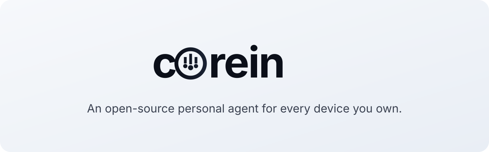

<p align="center">
  
</p>

**corein is an open-source personal agent for every device you own.** One agent with a name and a look of its own: it does things instead of answering questions, keeps working while the app is closed, remembers you, and stops to ask before anything you could not undo.

The whole set is small enough to run and deploy yourself: the phone app, the desktop app, the web console and the relay that joins them are all in this repository, under GPL-3.0-or-later. Bring a model key of your own; the relay you sign in to does sign-in, the hub and conversation sync, and never sees your key.

corein is a fork of [nanoMuse](https://github.com/nano-muse/nanoMuse) by Guangyi Liu, Yong Liu and Jiangning Zhang (Zhejiang University). See [Origin](#origin).

## Install

| | |
|---|---|
| **Android** 8.0+, arm64 | `corein-<version>-arm64.apk` from the [latest release](https://github.com/shaikfareed22/corein2026/releases/latest): every version is signed with the same key and installs over the last |
| **iPhone / iPad** | TestFlight link to come; [iOS](docs/ios.md) says how to build it yourself |
| **macOS** 12+ | `corein-Desktop-<version>-mac-arm64.dmg` and `-mac-x64.dmg`. Not notarised: right-click → *Open* the first time |
| **Windows** 10+ | `corein-Desktop-<version>-win-x64.exe`: click *Run anyway* once |
| **Linux** x64 | AppImage, .deb and tar.gz |
| **Docker** | `bash scripts/self-host.sh --local` for your own relay; `docker compose up -d app` for the web app on a server of yours; see [self-hosting](docs/self-hosting.md) |

Open the app, sign in with an e-mail address, add a model key under *Settings → Models*, and it has a model to think with. The phone, the desktop and the web share one account and show the same conversations.

## What it does

<table>
  <tr>
    <td width="50%" valign="top"><b>Does things.</b><br>A Linux shell, a browser, MCP servers and skills, and, with <i>Hands</i> on, the apps on your phone and the windows on your computer through their screens, for everything that never had an API.</td>
    <td width="50%" valign="top"><b>Asks first.</b><br>A stop before deleting, sending or paying, remembered for once, this chat or always; passwords and codes are yours to type. A login or a CAPTCHA is handed to you, <i>Done</i> resumes.</td>
  </tr>
  <tr>
    <td width="50%" valign="top"><b>Reaches your other devices.</b><br>Say it on the phone, it runs on your PC; <code>@PC …</code> at the start of a message sends the task there. Approvals come back to the device in your hand.</td>
    <td width="50%" valign="top"><b>Keeps going.</b><br>Goals checked on a schedule, routines that run while the app is closed, a feed written for you each morning.</td>
  </tr>
  <tr>
    <td width="50%" valign="top"><b>Remembers you.</b><br>What it is, what it knows about you and when it wakes are Markdown files you can read and edit.</td>
    <td width="50%" valign="top"><b>Lives in your chat apps.</b><br>It answers in Telegram, 飞书, 钉钉 and 企业微信.</td>
  </tr>
  <tr>
    <td width="50%" valign="top"><b>A look of its own.</b><br>Describe one, your image model draws it, a video model makes it move. A small dragon by default.</td>
    <td width="50%" valign="top"><b>Any model.</b><br>Your own key at one of twenty-one providers (Google Gemini, OpenRouter, OpenAI, DeepSeek, Bailian and more), or a plan you already pay for: ChatGPT, Claude, Kimi. A provider without picture or video models leaves those two off, and the app says so.</td>
  </tr>
</table>

## How it works

Each device runs its own agent: the phone inside the APK (Alpine Linux under proot, a shell, a browser, MCP), the computer inside corein Desktop (DeepSeek Harness with the Python runtime for the hands). Signed in, they meet on the relay and can ask each other for things; the text of the conversations travels through it, files and screenshots stay where they were made.

[docs/every-device.md](docs/every-device.md) explains the devices, [docs/hub.md](docs/hub.md) the frames, [docs/cloud.md](docs/cloud.md) the relay, [docs/privacy.md](docs/privacy.md) what it keeps.

## Docs

The sources are in [docs/](docs/): install per platform, every device, hands, connectors, memory, self-hosting, the protocols. What changed in each version is in the [CHANGELOG](CHANGELOG.md).

## Self-host

One VPS, one hour: [docs/self-hosting.md](docs/self-hosting.md). Three ways: no server at all with your own key, your own relay with `scripts/self-host.sh`, or a runtime of your own for the web app.

## Contribute

Use it for a real task, report what broke, then pick something focused: [CONTRIBUTING.md](CONTRIBUTING.md) has the setup and the conventions, [AGENTS.md](AGENTS.md) the rules a coding agent follows in this tree. Commits carry a DCO sign-off.

## Origin

corein forks [nanoMuse](https://github.com/nano-muse/nanoMuse) at version 1.0.5 (commit `821b7f6`, 2026-10-17) and changes its name, identifiers, brand and defaults; the agent, the relay, the protocols and the apps are nanoMuse's work, under the same licence. The paper that describes the design:

```bibtex
@misc{liu2026nanomuseopensourcepersonalagent,
      title={nanoMuse: An Open-Source Personal Agent for Every Device You Own},
      author={Guangyi Liu and Yong Liu and Jiangning Zhang},
      year={2026},
      eprint={2610.08699},
      archivePrefix={arXiv},
      primaryClass={cs.AI},
      url={https://arxiv.org/abs/2610.08699},
}
```

nanoMuse itself stands on [OpenMinis](https://github.com/OpenMinis/OpenMinis) (the phone app), [DeepSeek Harness](https://github.com/deepseek-ai/deepseek-harness) (the desktop) and [UI-TARS-desktop](https://github.com/bytedance/UI-TARS-desktop) (the desktop hands' operator); [THIRD_PARTY_NOTICES.md](THIRD_PARTY_NOTICES.md) has every component and its terms. The names and logos of those projects are theirs and are not used by corein.

## Disclaimer

corein is an independent project, not affiliated with or endorsed by nanoMuse, OpenMinis, DeepSeek, or Meta Platforms, Inc.; Muse is Meta's trademark.

## License

[GPL-3.0-or-later](LICENSE). See [NOTICE](NOTICE) for the derivation from nanoMuse and OpenMinis.
